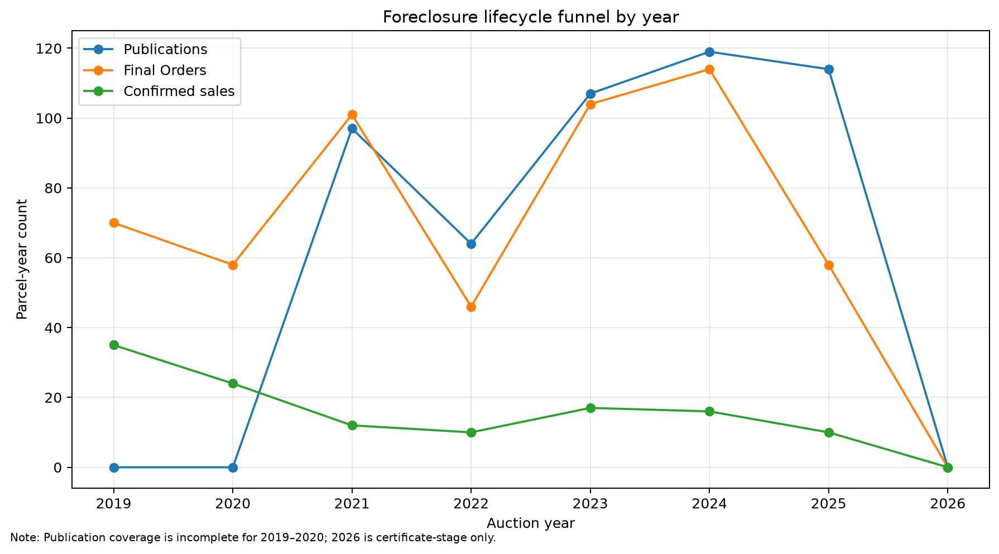
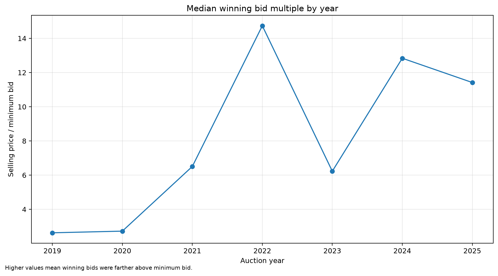

# Snohomish County Tax Foreclosure Analyzer

A point-in-time public-data project that reconstructs how properties move through Snohomish County's tax-foreclosure process and what happens when they reach auction.

> **[Download the dataset (Excel)](outputs/public/unified_parcel_lifecycle.xlsx?raw=1)**  
> No code required. The workbook includes the parcel-level lifecycle table, source-stage records, an annual summary, and dataset notes.

**790 parcel-year records · 501 publication records · 551 final-order records · 124 confirmed sales · source coverage from 2019–2026**

The counts above describe the records currently loaded into this project. Coverage differs by source and year, so they should not be read as complete counts for every stage across the full period.

---

## What this project does

Snohomish County publishes tax-foreclosure information across separate documents rather than as one analysis-ready dataset. Depending on the year and stage, those records include certificates of delinquency, publication notices, final orders of sale, returns of sale, and excess-funds records.

This project links those records by parcel and auction year into a single lifecycle:

```text
Certificate of Delinquency
        ↓
Affidavit of Publication
        ↓
Final Order of Sale
        ↓
Return of Sale
        ↓
Excess Funds, where available
```

The result is a reusable dataset for studying how properties move through the process, how many actually reach sale, and how auction outcomes compare with the minimum bids listed in foreclosure records.

---

## Why I built it

I started this project to better understand tax-foreclosure auctions and the public records behind them.

The more interesting problem turned out to be the data itself. The information exists, but it is spread across PDFs with different layouts, different levels of structure, and different coverage by year. Some records are machine-readable; others require OCR. The useful unit of analysis is not any one document, but the parcel tracked across documents.

So the core of the project became:

```text
Public county records
        ↓
PDF extraction + OCR
        ↓
Standardize parcel IDs and fields
        ↓
Link records by parcel + auction year
        ↓
Preserve source and data-quality flags
        ↓
Unified parcel lifecycle dataset
```

This repository is a finished point-in-time research project rather than an actively maintained foreclosure listing service.

---

## What is in the dataset?

The main workbook is:

**[Download `unified_parcel_lifecycle.xlsx`](outputs/public/unified_parcel_lifecycle.xlsx?raw=1)**

It contains four sheets:

| Sheet | What it contains |
|---|---|
| **Parcel Lifecycle** | One row per parcel-year, combining foreclosure stages and auction outcomes |
| **Stage Events** | The underlying source observations used to build the lifecycle table |
| **Annual Summary** | Counts by year across the major stages |
| **README** | Coverage and dataset notes |

Useful fields include parcel number, auction year, stage flags, situs address, property-use description, assessed-value fields where available, minimum bid, selling price, buyer, excess funds, source references, and OCR/data-quality flags.

For technical users, the repository also contains CSV/JSON outputs and the Python pipeline used to create them.

---

## What the data shows

### 1. Appearing in foreclosure records is not the same as being sold

A property can appear at an earlier foreclosure stage and never show up in a confirmed Return of Sale. That makes the lifecycle itself important: looking at a publication notice or final order in isolation can overstate the number of properties that ultimately sell.



Coverage is strongest for confirmed sales and final orders. Publication coverage is usable for 2021–2025; earlier publication records are incomplete.

### 2. Minimum bid is a starting point, not a likely purchase price

For the 124 confirmed sales in the current dataset, winning prices often moved well above the listed minimum bid. The size of that gap also varies substantially by year and property.



The project records both the dollar premium above minimum bid and the sale-price-to-minimum-bid multiple so the relationship can be analyzed directly.

### 3. Repeat participation exists, but most buyer records are one-offs

The Return of Sale records include both one-time purchasers and buyers who appear more than once. The repository preserves this information for analysis while also generating a public-safe repeat-buyer table with anonymized labels.

I treat repeat participation as a descriptive pattern rather than assuming that every repeat buyer is a professional investor.

---

## Data coverage

| Source layer | Coverage in this project | Status |
|---|---:|---|
| Return of Sale / auction sales | 2019–2025 | Strong |
| Final Order of Sale | 2019–2025 | Usable with OCR caveats |
| Affidavit of Publication | 2021–2025; 2020 unresolved | Usable with caveats |
| Certificate of Delinquency | Partial, strongest for 2024 and 2026 | Partial |
| Excess funds | Exact matches currently loaded for 2024–2025 | Partial |
| Assessor / GIS enrichment | Not added | Out of scope |

The project deliberately keeps coverage gaps and review flags visible rather than treating every source as complete.

---

## How the dataset was built

The pipeline combines machine-readable county records, OCR-derived records, manually normalized auction-sale data, and excess-funds data.

A few design choices matter:

- **Parcel numbers are standardized** before records are matched.
- **Parcel + auction year** is the main lifecycle key.
- **Source references are retained** so records can be traced back to the underlying documents.
- **OCR review flags are preserved** rather than silently treating uncertain extractions as clean data.
- **Later-stage auction records are not assumed to imply complete earlier-stage coverage.**

The main transformation logic is in [`src/transform/build_unified_lifecycle.py`](src/transform/build_unified_lifecycle.py).

---

## Reproduce the project

From the repository root:

```powershell
python -m src.inventory.build_source_inventory
python -m src.extract.parse_machine_readable_stage_records
python -m src.extract.ocr_scanned_final_orders
python -m src.extract.ocr_scanned_affidavits
python -m src.transform.build_unified_lifecycle
python -m src.analysis.build_coverage_audit
python -m src.analysis.build_analysis_outputs
python -m src.analysis.build_report_graphs
```

The OCR steps require Tesseract OCR. Raw public-source PDFs are intentionally not committed to the repository.

---

## Limitations

This is a research dataset assembled from public records, not a complete legal history of every parcel.

The main limitations are straightforward:

- source coverage differs by year;
- some scanned documents required OCR and retain review flags;
- 2020 publication records remain unresolved;
- certificate-stage coverage is incomplete across earlier years;
- county assessed values should not be treated as current market values.

Those limitations are part of the dataset rather than something the project tries to hide.

---

## Repository structure

```text
docs/                 charts and methodology notes
outputs/public/       downloadable public outputs
src/analysis/         analysis and chart-generation code
src/data/             structured source data
src/extract/          PDF and OCR extraction
src/transform/        lifecycle construction
```

---

## Public-use note

Buyer and property-owner names in the source data were transcribed from publicly available Snohomish County tax-foreclosure records. This project is intended for historical research, public-interest analysis, education, and reproducibility. It is not intended as a marketing, solicitation, lead-generation, or contact list.

## License

MIT License.
